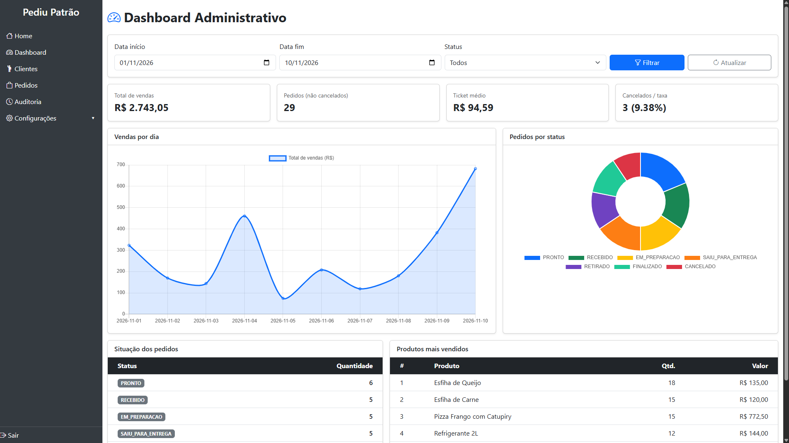
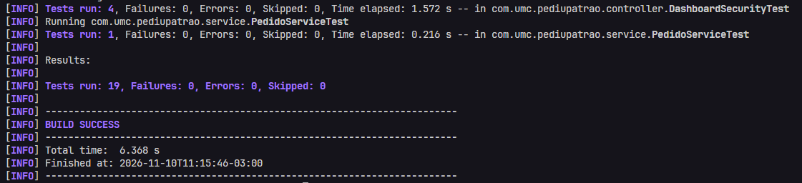

# Pediu Patrão

O Pediu Patrão é um sistema de pedidos para pizzaria, desenvolvido como projeto de Engenharia de Software. O objetivo é organizar a operação do estabelecimento: cada perfil possui atribuições próprias, e o pedido percorre etapas definidas desde o recebimento até a entrega ou a retirada.



## Funcionalidades

O atendente cadastra o cliente, compõe o pedido com os itens do cardápio e acompanha o status até a conclusão. O valor de cada item é obtido do cadastro do produto, e o total é calculado pelo sistema.

O sistema também mantém:

- produtos do cardápio
- clientes e endereço de entrega
- funcionários e entregadores
- horário de atendimento
- usuários, cada um associado a um perfil
- registro de auditoria nas inclusões e alterações de pedidos e clientes

Gerente e administrador dispõem de um dashboard com total de vendas, quantidade de pedidos, ticket médio, quantidade de cancelamentos, gráfico de vendas por dia, distribuição por status e ranking dos produtos mais vendidos. Faturamento e ranking consideram apenas pedidos com status diferente de `CANCELADO`.

O detalhamento dessa funcionalidade está na seção [Documentação](#documentação).

## Perfis de acesso

| Perfil | Atribuições |
| --- | --- |
| Atendente | Cadastra e altera clientes e pedidos e avança o status do pedido. |
| Gerente | Executa as operações do atendente, cadastra produtos, funcionários, entregadores e horários, aplica desconto, cancela pedido, consulta a auditoria e acessa o dashboard. |
| Administrador | Executa as operações do gerente, gerencia os usuários do sistema e pode excluir clientes. |

Desconto e cancelamento são restritos aos perfis gerente e administrador. O desconto máximo é de 20%. O cancelamento exige justificativa, e o pedido permanece armazenado com o status `CANCELADO`.

Na primeira execução, o sistema cria três usuários de demonstração, caso ainda não existam. A senha dos três é `teste123`.

| Usuário | Perfil |
| --- | --- |
| `admin` | Administrador |
| `gerente` | Gerente |
| `atendente` | Atendente |

## Fluxo do pedido

Todo pedido é criado com o status `RECEBIDO`. As transições seguintes obedecem à ordem abaixo.

```text
RECEBIDO → EM_PREPARACAO → PRONTO → SAIU_PARA_ENTREGA ou RETIRADO → FINALIZADO
```

`CANCELADO` encerra o pedido por outro caminho. O cancelamento é permitido apenas enquanto o status for `RECEBIDO` ou `EM_PREPARACAO`.

## Organização do código

O projeto segue a separação de responsabilidades usual do Spring Boot:

- `controller`: recebe a requisição da interface ou da API e devolve a resposta
- `service`: concentra as regras de negócio (total do pedido, desconto, transição de status e auditoria)
- `repository`: realiza o acesso aos dados
- `entity`: representa os documentos persistidos (pedido, cliente, produto e usuário)
- `dto`: transporta os dados de entrada e saída da API
- `config`: define a segurança, os usuários iniciais e os dados de demonstração do dashboard

A interface utiliza Thymeleaf e Bootstrap. O dashboard consome a API em `/api/dashboard`, em JSON, e renderiza os gráficos no navegador. As agregações que alimentam esses indicadores são executadas no MongoDB.

## Tecnologias

- Java 21
- Spring Boot 3 (web, validação e segurança)
- Spring Data MongoDB
- Thymeleaf
- Maven, por meio do wrapper `mvnw`

O MongoDB foi adotado pela flexibilidade dos documentos de pedido, item e cliente e pelo suporte a agregações utilizadas no dashboard.

## Documentação

A pasta `docs/` reúne a especificação do dashboard:

- [Requisitos do dashboard](docs/requisitos.md): indicadores, filtros e regras de acesso.
- [API do dashboard](docs/api-dashboard.md): endpoints, parâmetros e exemplos de resposta em JSON.

## Execução

1. Instalar o Java 21.
2. Disponibilizar uma instância do MongoDB, local ou remota.
3. Configurar a conexão em `src/main/resources/application.properties`, nas propriedades `spring.data.mongodb.uri` e `spring.data.mongodb.database`. A variável de ambiente `SPRING_DATA_MONGODB_URI` sobrescreve o valor definido no arquivo, o que evita gravar a senha no repositório.
4. Na raiz do projeto, executar:

```bash
./mvnw spring-boot:run
```


A aplicação fica disponível em `http://localhost:8080`, com autenticação em `/login`.

Durante a inicialização, o sistema cria um cardápio, clientes e pedidos do mês corrente para que o dashboard apresente dados. Esses pedidos de demonstração são recriados a cada execução.

## Testes

Os testes automatizados são executados com:

```bash
./mvnw test
```
Resultados dos testes:

